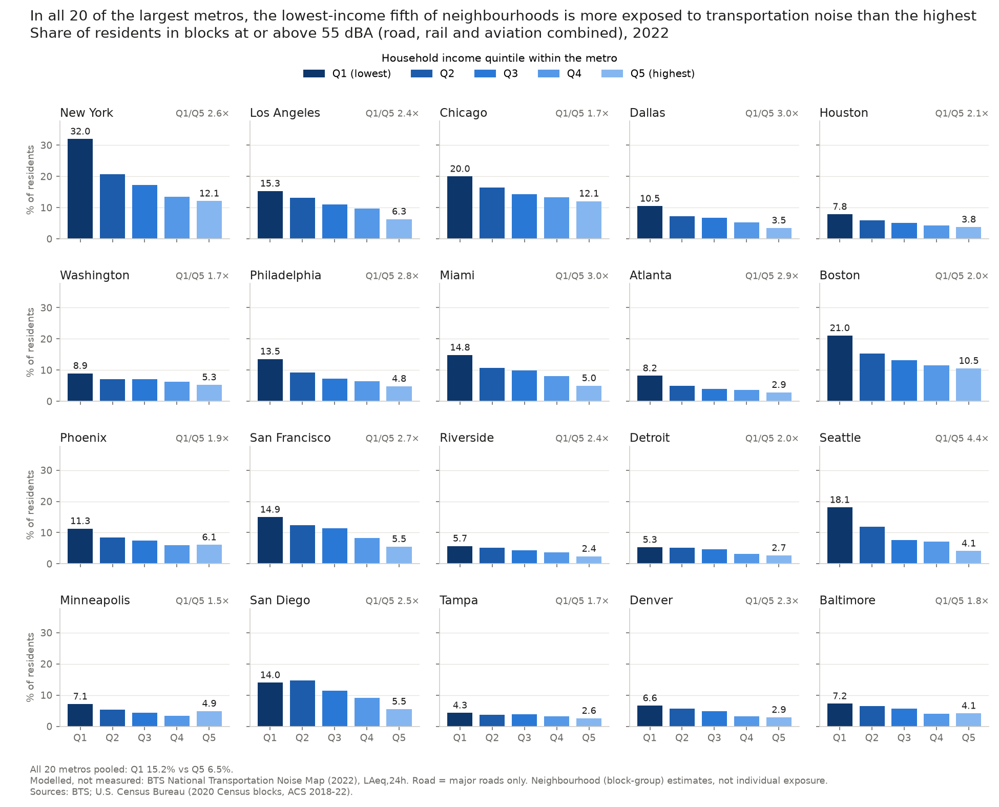
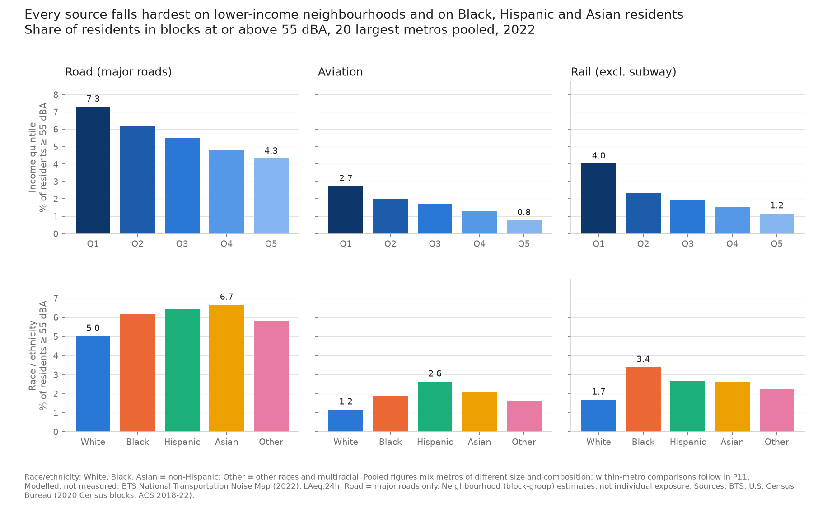
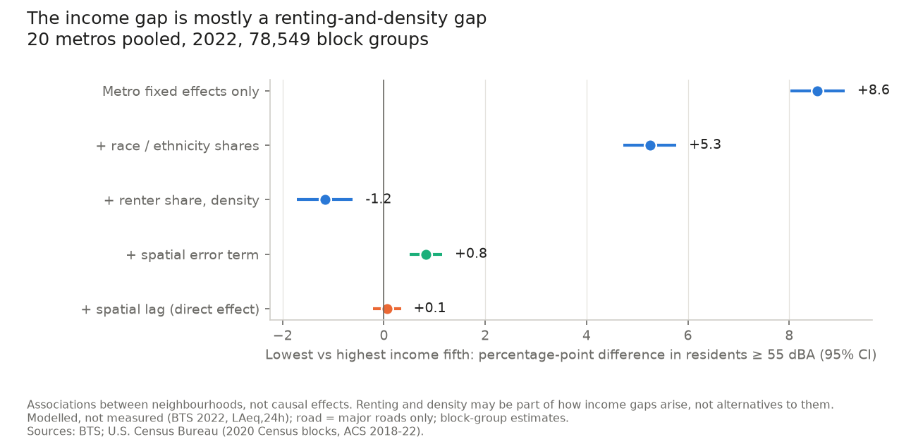
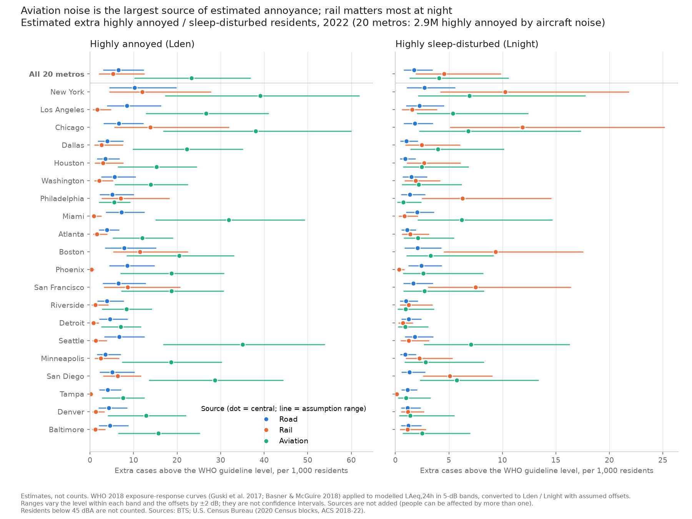
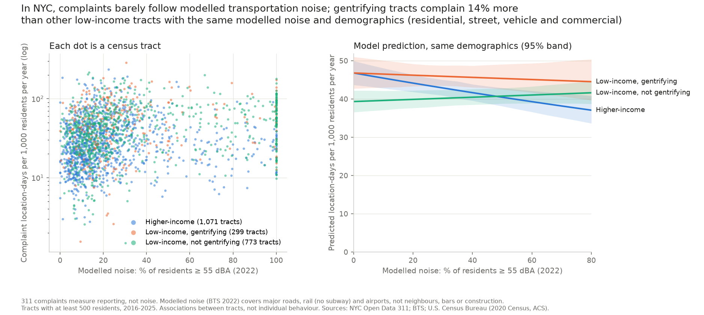
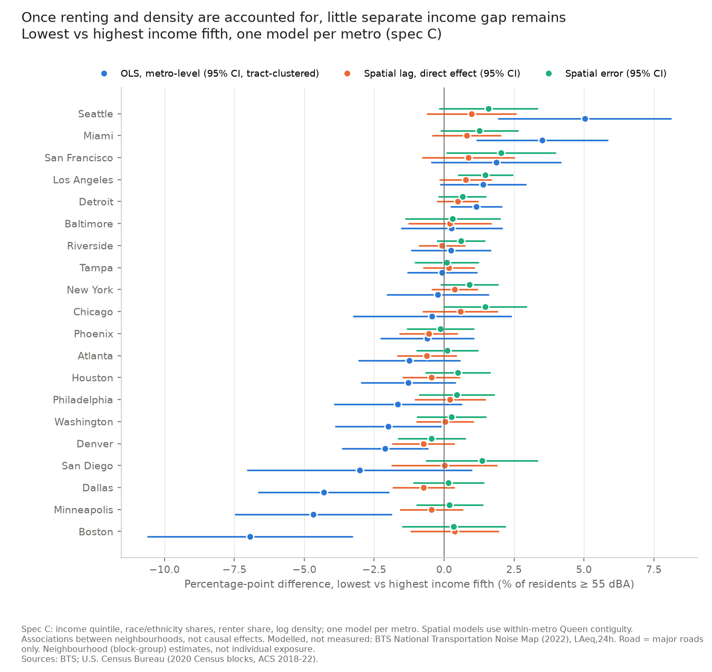
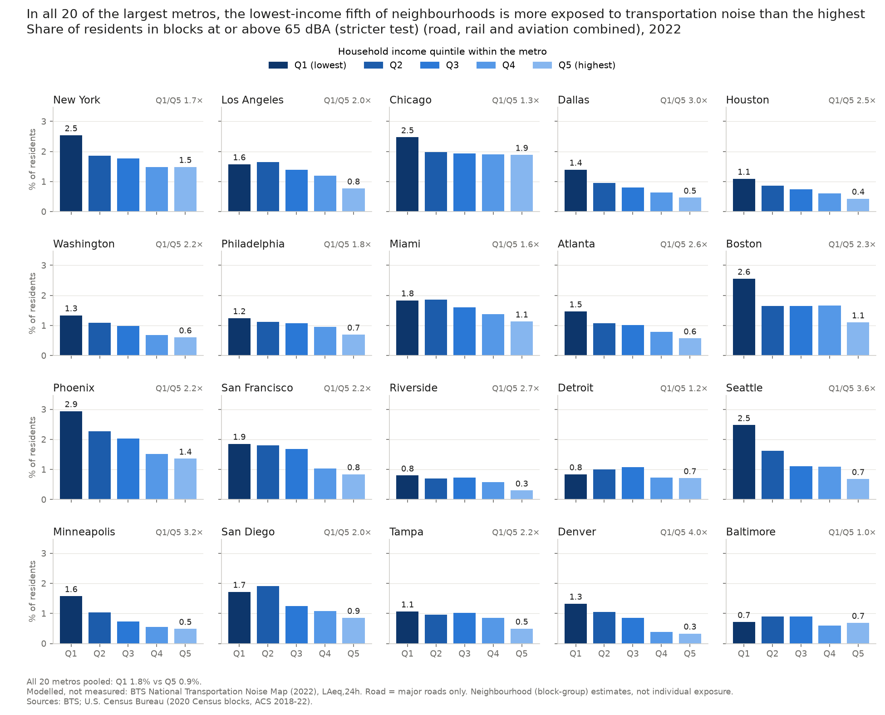
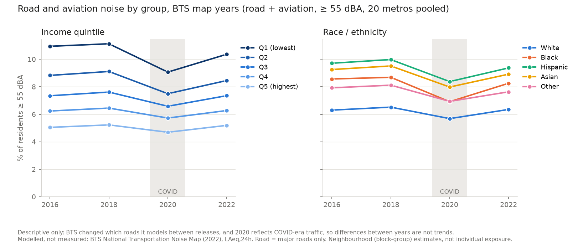

::: {.callout-note appearance="simple"}
**About these numbers.** Every noise level here is *modelled*, not measured. It comes
from the U.S. Bureau of Transportation Statistics' National Transportation Noise Map,
which estimates average 24-hour sound levels from road, rail and aircraft traffic. The
results describe **neighbourhoods**, not individual people or homes. "Road" means major
roads only: BTS does not model local streets. The rail layer does not include the New
York subway.
:::

## Key findings

- **The lowest-income fifth of neighbourhoods is louder than the highest-income fifth in all
   metros.** Across the 20 metros, % of residents in the lowest-income
  fifth live where modelled noise reaches 55 dBA or more, against % in the
  highest-income fifth:  times as many.
- **Every source follows the same pattern.** The gap between the lowest and highest income
  fifths is × for aircraft noise, × for rail and
  × for major roads.
- **Black, Hispanic and Asian residents are more exposed.** %,
  % and % of them live at 55 dBA or more, against
  % of White residents.
- **Renting and density carry most of the income gap.** Once we account for how many households
  rent and how densely a neighbourhood is built, little separate income gap remains.
- **At least  million residents are estimated to be highly annoyed by aircraft
  noise** beyond the WHO's recommended limit. Rail is the biggest source of estimated sleep
  disturbance.
- **In New York, complaints don't track transportation noise.** Gentrifying tracts file
  % more noise complaints than other low-income tracts with the same modelled
  noise and demographics.

## Who lives with the noise

We overlaid the BTS map's 30-metre grid on every 2020 census block in the 20 largest metro
areas. That covers  million people in  neighbourhoods (census block groups).
For each neighbourhood we measured the share of residents living where modelled noise is at
least 55 dBA. That is roughly the level of a busy street heard from the pavement, all day and
night on average. The WHO recommends keeping road traffic noise below about 53 dB on its
day-evening-night measure.

Across the 20 metros, % of residents live at 55 dBA or more, and % at 65 dBA or more.
Those people are not spread evenly.

{#fig-hero .column-page}

Sort each metro's neighbourhoods into fifths by median household income. In every metro, the
poorest fifth has a larger share of residents at 55 dBA or more than the richest fifth. The
gap is widest in  (×) and narrowest in 
(×). The pattern holds at the stricter 65 dBA threshold:
% against %, or ×. A version of the chart at that level is in the
appendix.

### Every source, same direction

{#fig-sources .column-page}

The pattern does not depend on one kind of traffic:

- **Major roads:** % of residents in the lowest-income fifth, against
  % in the highest.
- **Rail:** % against %.
- **Aircraft:** % against %.

By race and ethnicity, rail noise falls hardest on Black residents: % at 55 dBA or
more, against % of White residents. Aircraft noise falls hardest on Hispanic
residents: %, against %. These pooled race figures partly
reflect which metros each group lives in. The models below compare neighbourhoods within
each metro.

### What it looks like on the ground

.](../figures/chart2_bivariate_nyc.png){#fig-map .column-page}

In New York, the loud, lower-income neighbourhoods (darkest blue) cluster in a few places:
the South Bronx and Upper Manhattan along the expressways and rail lines, central Brooklyn,
around JFK, and the Newark–Elizabeth corridor beside Newark airport and the New Jersey Turnpike.

## Why: renting and density

Lower-income neighbourhoods are louder, but income is tangled up with other things. To
separate them, we compared neighbourhoods *within the same metro* (@fig-steps):

- **Within-metro gap:** the lowest-income fifth has  percentage points more residents
  at 55 dBA or more than the highest (95% CI ).
- **Adding race/ethnicity composition:** the gap shrinks to . About % of
  the income gap overlaps with race/ethnicity.
- **Adding renter share and density:** almost nothing is left (between  and
   points, depending on the model). Each 10 percentage points more renters goes with
   points more residents at 55 dBA or more.

{#fig-steps}

This does **not** mean the disparity is innocent. Renting and density are likely part of
*how* it arises:

- rental housing is cheaper beside highways, rail yards and flight paths;
- dense neighbourhoods were often cut through by expressways in the mid-20th century;
- households with fewer choices end up in the places others avoid.

The models show where the gap lives. They do not show it is acceptable.

Noise doesn't stop at neighbourhood boundaries, so neighbouring areas have very similar
exposure (Moran's I = ). We used spatial models that allow for this. They
give the same message: once renting and density are included, the separate income effect
is close to zero. A per-metro version is in the appendix.

## What it does to health

The WHO's 2018 noise guidelines include exposure-response curves. They estimate the share
of people who are "highly annoyed" or whose sleep is "highly disturbed" at a given level of
road, rail or aircraft noise. We applied them to the modelled exposure and counted only the
*extra* cases above the WHO's recommended limit for each source.

| Extra residents, 20 metros (millions) | Major roads | Rail | Aircraft |
|---|---|---|---|
| Highly annoyed |  () |  () | **at least ** () |
| Highly sleep-disturbed |  () | **** () |  () |

: Estimated extra highly annoyed and highly sleep-disturbed residents above WHO guideline levels. Ranges vary our assumptions (see Methods); they are not statistical confidence intervals. Sources are not added, because one person can be bothered by several. {#tbl-health}

{#fig-health .column-page}

**Aircraft dominate annoyance.** The WHO curve for aircraft is steep and its limit is low
(45 dB). Our aircraft figure is a **lower bound**: the BTS map does not report levels below
45 dBA, which is just above the WHO aircraft limit. If everyone below the map's floor were
counted at 45 dBA, the estimate would rise to  million.

**Rail matters most at night,** because freight trains run around the clock.

The burden is unequal too. In the lowest-income fifth,  residents in every 1,000
are estimated to be highly annoyed by aircraft noise beyond the WHO limit. In the
highest-income fifth the figure is .

## Who gets heard: New York's noise complaints

If noise falls unequally, do complaints follow? We matched  million 311 noise
complaints (2016 to 2026) to New York's  census tracts. We counted each
location at most once per day per complaint type, which gives  million
"location-days". This matters: two buildings in one Bronx tract filed nearly 400,000 complaints
between them.

{#fig-nyc .column-page}

Two findings stand out.

1. **Complaints barely follow modelled transportation noise.** Ten percentage points more
   residents at 55 dBA or more go with a complaint rate ratio of  (95% CI
   ): no meaningful link. That is not surprising. Most complaints are about
   neighbours, parties, bars, construction and car alarms, which the BTS map does not model.
2. **Gentrifying neighbourhoods complain more.**
   - We defined gentrifying tracts as low-income tracts where the share of college graduates
     and rents both rose faster than the city median between 2016–20 and 2020–24.
   - These tracts file % more complaints per resident than other low-income
     tracts with the same modelled noise, race/ethnicity, renter share and income (95% CI
     %).
   - The difference is largest for street and sidewalk noise, at % more,
     and for residential noise, at % more.
   - Per 1,000 residents a year:  location-days in gentrifying tracts,
      in other low-income tracts and  in higher-income tracts.

We treat this section as **exploratory**. Complaints measure *reporting*, which depends on who
notices noise, who knows to call 311, and who expects a response. They do not measure noise.
The data cannot tell us whether newcomers or long-time residents are the ones calling.

## What we won't claim

- **Not measured noise.** These are model estimates of average 24-hour sound. BTS itself warns
  the map should not be used to judge individual locations.
- **Not individuals.** All results describe neighbourhoods. A low-income neighbourhood being
  louder does not mean any particular low-income household lives with more noise (the
  ecological fallacy).
- **Not all noise.** The map covers major roads, rail (not the subway) and aircraft. It leaves
  out local streets, construction, neighbours and nightlife, which are what most people
  complain about.
- **Not causes.** The models describe associations between neighbourhoods. They do not show
  that income, race, renting or density *cause* noise exposure, or the reverse.
- **Not trends.** BTS changes which roads it models between releases, and 2020 reflects
  COVID-era traffic. We do not read differences between map years as change over time
  (see the appendix).
- **Health numbers are estimates.** They rest on modelled noise, assumed conversions between
  noise measures, and curves estimated mostly in European studies.

# Appendix {.appendix}

## Methods

**Noise exposure.**

- Source: BTS National Transportation Noise Map for 2016, 2018, 2020 and 2022, as 30 m
  rasters of LAeq,24h for road, rail and aviation. Values below 45 dBA are not reported.
- Each 2020 census block was measured on its own state's raster with `exactextract`, which
  gives the share of the block's area at or above 45, 50, 55, 60, 65 and 70 dBA.
- Block shares were weighted by 2020 block population to give each block group's share of
  residents at or above each level.
- Sources were combined cell by cell with an energy sum, 10·log₁₀(Σ 10^(L/10)). Decibels are
  never averaged arithmetically.
- Our 20-metro share at 60 dBA or more on the 2020 map (%) matches the
  University of Washington's national estimate from the same map (%).

**Demographics.**

- Source: American Community Survey 5-year estimates (2018–22) from the Census Bureau API,
  on 2020 block groups: median household income, race/ethnicity, renter share.
- Income quintiles are formed within each metro and weighted by population, so each holds
  about a fifth of the metro's residents.
- Block groups with unreliable income estimates (coefficient of variation above 0.30) are kept
  but flagged. Dropping them changes nothing material.

**Models.**

- Ordinary least squares with metro fixed effects and standard errors clustered by tract.
- Spatial lag and spatial error models (generalised method of moments), using Queen
  contiguity weights within metros.
- 78,549 block groups.

**Health.**

- Residents were split into 5 dB bands and converted to Lden or Lnight. The assumed offsets
  are +3/−7 dB for road and aircraft and +5/−2 dB for rail, because freight runs at night.
- We applied the WHO 2018 curves (Guski et al. 2017 for annoyance; Basner & McGuire 2018 for
  sleep) and counted cases above each source's guideline level.
- Ranges vary where residents sit within each band and shift the offsets by ±2 dB.

**New York complaints.**

- Negative binomial models of 311 location-days per tract and year, 2016–2025.
- Offset: tract population. Fixed effects: borough and year. Standard errors clustered by
  tract.
- Helicopter complaints are excluded, because the BTS aviation layer models airports, not
  helicopter routes.

**Robustness.** We re-ran every headline result 72 ways:

- thresholds from 45 to 70 dBA;
- area instead of population weighting;
- the 2020 map;
- dropping unreliable income estimates;
- raw complaint counts;
- excluding Manhattan;
- a different gentrification definition;
- different floors and offsets for the health estimates.

The ratio between the lowest- and highest-income fifths stayed between ×
throughout. The full grid is `data/processed/robustness_grid.csv`.







## Data sources and citations

- U.S. Department of Transportation, Bureau of Transportation Statistics. *National
  Transportation Noise Map* (2016, 2018, 2020 and 2022 releases). Public domain.
- U.S. Census Bureau. *2020 Census Redistricting Data (P.L. 94-171)*; *2020 TIGER/Line
  Shapefiles*; *American Community Survey 5-year estimates*, 2016–2020, 2018–2022 and
  2020–2024, via the Census Data API. Public domain.
- City of New York. *NYC Open Data: 311 Service Requests* (datasets `76ig-c548` and
  `erm2-nwe9`). Published here as tract-level counts only.
- WHO Regional Office for Europe (2018). *Environmental Noise Guidelines for the European Region.*
- Guski R., Schreckenberg D., Schuemer R. (2017). WHO Environmental Noise Guidelines for the
  European Region: a systematic review on environmental noise and annoyance. *IJERPH* 14(12):1539.
- Basner M., McGuire S. (2018). WHO Environmental Noise Guidelines for the European Region: a
  systematic review on environmental noise and effects on sleep. *IJERPH* 15(3):519.
- University of Washington DEOHS. *National Transportation Noise Exposure Map* (benchmark only).
- Basemap for the interactive map: Esri, HERE, Garmin, © OpenStreetMap contributors.

No IPUMS NHGIS data were used.

## Look up your neighbourhood

The [neighbourhood lookup](../app/) shows the same 2022 estimates for any address in the 20 metros.

## Reproduce it

The code, the processed tables and these figures are in the project repository.

```bash
uv sync               # Python 3.12 environment
make ingest           # downloads (BTS zips must be fetched in a browser; see DATA.md)
make build models figures
uv run python -m ne.report && quarto render report
```

Every number in this article is a variable computed from the result tables. The list of
claims and their sources is in `report/claims.csv`.
